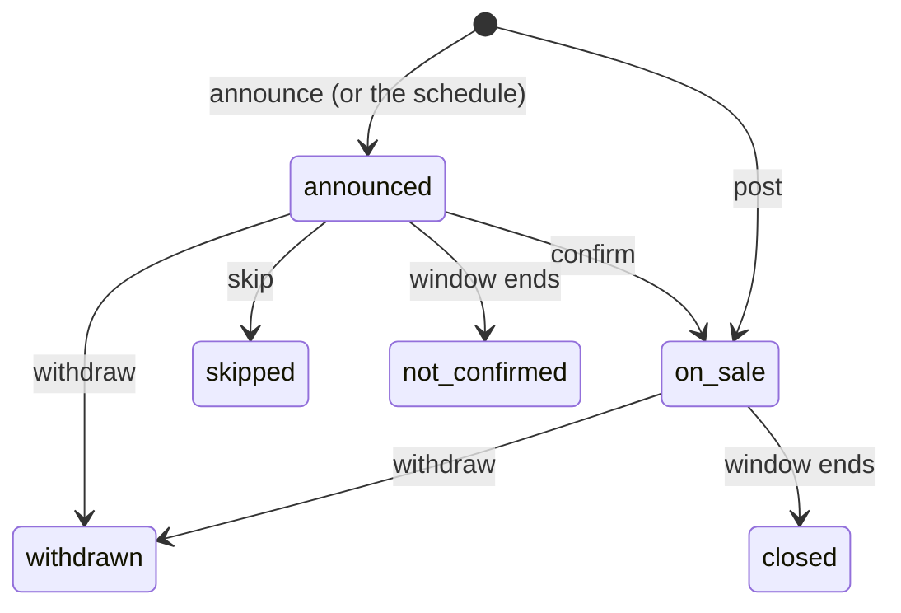

# SEC-11 — The `offer` module: design

Status: business flow decided with the team on 18 October 2026; not built ([plan](plan.md)). Tracked in Linear as SEC-11.

The flow below was worked out one part at a time from the products read for the [offer models](../../../research/2026-10-17-offer-models.md) note, the [pilot domain model](../sec-6-pilot-domain-model/design.md) and the founder's requirements. Each rule names its source; a rule marked *ours* has none and is a working assumption.

## What a person can do

**A seller's staff member** (owner or staff of an `active` seller):

- posts surplus with one photo, a name, the units, the price and the original price, and is shown to customers at once;
- posts again from an earlier offer, typing only the units and the collection window;
- announces surplus expected later in the day, or keeps a weekly schedule that announces it, then confirms it with the real units or skips the day;
- changes an offer, within what its orders allow, and withdraws it;
- sees how many customers follow the seller and each announcement.

**A customer:**

- finds offers and announcements near a point, by name, kind, price and collection time, and sees each one's photo, price against the original price, units left, window, seller and distance;
- follows a seller, to be told when it posts or announces, and follows one announcement, to be told once when it is confirmed or skipped.

**An admin** changes the platform's offer settings.

Ordering an offer is SEC-15 (`order`), paying SEC-18, the screens SEC-17, drafting an offer with AI SEC-16.

## The flow

### 1. Posting an offer

| Field | Rule | Source |
| --- | --- | --- |
| Photo | Required, one | Founder's requirements ("ảnh"); foodsharing, Open Food Network |
| Name | Required, 1 to 80 characters | Every reference |
| Units | Required, a whole number from 1 to 999 | Open Food Network (`on_hand`) |
| Price per unit | Required, in đồng, at least 1,000 | Open Food Network |
| Original price per unit | Required; the price must be at least the minimum discount below it | Too Good To Go (price against retail value); founder, 18 October 2026: at least 20%, the seller may give more |
| Kind | Required, with a default: `bakery`, `prepared_food`, `ingredients`, `drinks`, `mixed_box`, `other` | Too Good To Go, Open Food Network (one category); [Sharing Excess](../../../research/2026-10-17-sharing-excess-impact.md) (a category to measure by) |
| Unit | Required, with the default "suất"; free text up to 20 characters ("hộp", "cái", "kg") | Open Food Network (`unit_name`) |
| Collection window | Required: a start and an end; see the [settings](#settings) for its bounds | Umi Feeds (start and end); Open Food Network's free-text pickup time as the counter-example |
| Description | Optional, up to 1,000 characters; required for a `mixed_box`, which is described by what it may hold; allergens are written here | Domain model assumption 6; Too Good To Go makes no promise about a bag's contents |
| Weight per unit | Optional, in grams | Domain model assumption 9; Sharing Excess |

- The collection point (location and address) is copied from the seller when the offer is posted; a seller that moves changes later offers only (domain model, section 4).
- A posted offer is visible at once; there is no draft. Drafts arrive with AI in SEC-16 (domain model, glossary).
- **Posting again**: the client reads an earlier offer of the seller and posts a new one with its name, kind, unit, description, weight, prices and photo, the staff member typing the units and the window. Nothing links the two offers; the photo is shared, not copied. *(Ours: Too Good To Go and Open Food Network declare a product once and change only the quantity; a copy gives the same effort without a catalogue to manage.)*

### 2. Announcing expected surplus

The founder's brief: *"Expected surplus can be followed without purchase; confirmed stock can be reserved."*

- An **announcement** holds the same fields as an offer, with an estimated number of units instead of units. Customers see it marked as expected and follow it; nobody can order it.
- The staff member **confirms** it with the real units, and may correct the window, the prices and the description; it becomes an offer for sale, under the same rules as one posted directly. Or they **skip** it, when nothing is left.
- An announcement neither confirmed nor skipped by the end of its window is closed as not confirmed.
- **A weekly schedule** announces it without anyone typing: for each schedule the seller keeps the offer's fields, the days of the week, the estimated units and the window as times of day. Each scheduled day, at the start of the day (Asia/Ho_Chi_Minh), an announcement is made from it. A schedule is paused or deleted by the seller's staff; deleting it leaves the announcements it made. *(Too Good To Go keeps a weekly schedule with a quantity and a collection time per day; Karrot and foodsharing keep recurring pickups. Unlike Too Good To Go, a scheduled day is only announced, never sold, until staff confirm it: the pilot takes cash and bank transfers, whose refunds are made by hand.)*

### 3. Changing and withdrawing

| While | May change | Source |
| --- | --- | --- |
| No unit has been ordered | Everything but the seller and the collection point | foodsharing lets the owner change everything |
| Units have been ordered | The description, the photo and the units, never below the units ordered; the price, the original price and the window stay | Open Food Network copies price and name onto the order line; Karrot refuses to move a booked activity |
| The window has ended | Nothing | — |

- **Withdrawing** removes the offer or the announcement from every customer's read. An offer with orders is never deleted; it keeps its row with the time it was withdrawn ([deletion](../../../guidelines/persistence.md#deletion)). Cancelling its orders and telling their customers arrives with SEC-15, which publishes the first order and is the first listener of `offer.WithdrawnEvent`; until then no order exists to cancel.
- Units ordered are counted by `order` through `offer`'s published API when SEC-15 lands; until then an offer's units left equal its units.

### 4. The life of an offer

- *Sold out* is not a state: an offer on sale with no units left stays visible as sold out, and is on sale again when a cancellation returns units (Too Good To Go keeps sold-out bags visible; Open Food Network returns units on cancellation).
- *Closed* and *not confirmed* are read from the window's end in every query, so nothing waits for a job (foodsharing filters `until > NOW()` in its queries).

### 5. Finding offers

- Near a point, within a radius ([settings](#settings)), nearest first; without a point, by name or seller, soonest window first. *(foodsharing: a bounding box, then the exact distance, with a default and a maximum radius.)*
- Filters: words in the name (accents ignored, so "banh mi" finds "bánh mì"), kinds, a maximum price, a collection time the window must include, one seller.
- Results hold offers on sale and announcements whose window has not ended, each with its photo, name, kind, price, original price and discount, units left (or estimated units), unit, window, the seller's name and photo, and the distance. Sold-out offers are included and marked.
- A seller's public page: its name, photo, address, location and follower count, and its offers and announcements.

### 6. Following

- **A seller**: the customer is emailed when the seller posts an offer or makes an announcement. *(Too Good To Go's favourites; Karrot members opt in to an email for every new offer.)*
- **An announcement**: the customer is emailed once, when it is confirmed or skipped (domain model assumption 5, extended to the skip).
- One email per post however many follows match it; a customer follows or unfollows in one tap; staff see the counts, never who follows.
- Email is the only channel until push arrives with the mobile application (SEC-12).

### 7. The seller's photo

Moved here from SEC-10: a seller has one optional photo, set by its owner, shown on its public page and beside its offers.

## Settings

Changed by admins at runtime (`GET` and `PUT /admin/offer-settings`), kept in one row as the email settings are.

| Setting | First value | Basis |
| --- | --- | --- |
| Minimum discount | 20% | Founder, 18 October 2026 (replaces domain model assumption 3, 0%) |
| Search radius | 5 km by default, 30 km at most | *Ours*: about 15 to 20 minutes by motorbike in Hanoi; foodsharing's 30 and 50 km suit a German region, not a city |
| Collection window | 30 minutes to 6 hours long; it starts within 24 hours of posting | Too Good To Go advises about an hour; *ours* for the rest: longer windows serve the brief's "inconvenient pickup times", six hours bounds freshness, and surplus is a same-day matter |

The customer's daily limit of units (domain model assumption 4, 10 to start) is checked when ordering and belongs to SEC-15.

## Photos

- One photo per offer, and per seller. JPEG, PNG or WebP, at most 10 MB. iPhone browsers turn their HEIC photos into JPEG when a page asks for an image, so HEIC is not accepted by the server; this is checked on a device during verification.
- Every photo is decoded and written again as JPEG in two sizes, 1,600 and 400 pixels on the longer side, so no metadata (location, device) survives and a list loads quickly on a phone. *(Open Food Network resizes to four sizes.)*
- Photos are not reviewed before they are shown; staff answer for them and an admin removes one on a report (founder's requirements, section 10).
- A photo uploaded and never used by an offer or a seller is deleted after a day.
- **Anyone signed in may upload**, not only a member of an active seller: `media` cannot ask `seller`, which asks `media` for the seller's photo. A photo is used only by the account that uploaded it (`Claim`), and an account holds at most 20 unused photos until they are deleted after a day. `offer` lets staff post again with a photo an earlier offer of the same seller already uses.
- The image is the request's body, not a multipart form: huma bounds a body's size, not a form's.
- **Where the files are kept**, a [Strategy behind a registry](../../../conventions.md#interchangeable-implementations-strategy-behind-a-registry) as the domain model asks for storing images: a `Store` that puts, gets and deletes a file by its key. The first implementation keeps files in PostgreSQL (`bytea`), so the pilot runs no other service, and one backup holds data and photos (Memos keeps attachments in its database the same way, with `DATABASE`, `LOCAL` and `S3` stores, each attachment recording its own: `store/storage.go`, column `storage_type`). Files are stored before the photo's row, which no store's transaction covers, and deleted again when the row is refused. The second, when the database grows too large or the service runs on several machines, is any S3-compatible store (AWS S3, Cloudflare R2, Garage, SeaweedFS, MinIO) through one S3 client. The store is chosen by configuration at startup, not by admins at runtime: switching without moving the files would lose photos. Each photo records the store that holds it, so photos already kept stay readable after a switch, and `secondbite media move` copies them across.
- Customers read photos through the API (`GET /photos/{photoId}/{size}.jpg`), never from the store directly, so a switch changes no address. A photo never changes once written; it is served with a cache of a year.
- MinIO's community edition is no longer a candidate: it stopped publishing builds in October 2025 and was put in maintenance mode in December 2025.

## Boundary discovery

The [pilot domain model](../sec-6-pilot-domain-model/design.md) holds the story, the glossary, the commands and the owners; this increment adds what it did not settle.

**Glossary additions**

| Term | Meaning | Not to be confused with |
| --- | --- | --- |
| Announcement | The domain model's *expected surplus*: an offer announced before its stock exists | Offer on sale |
| Schedule | A seller's weekly plan of announcements | Opening hours |
| Follow | A customer's request to be told about a seller's posts, or about one announcement | Order |
| Photo | An image uploaded by a seller's staff for an offer or the seller | — |

**Owners**

| Module | Owns | Why |
| --- | --- | --- |
| `offer` | offers and announcements, schedules, follows, the offer settings | Units, publishing rules and the collection point are its invariants (domain model, section 4); a follow serves only offers |
| `media` (new) | photos and where their files are kept | `seller` and `offer` both need photos, and `seller` cannot call `offer`, which already calls `seller`; the domain model's registry for storing images moves here from `offer`, with PostgreSQL as its first store instead of a local directory |

**Edges** (the context map gains `media`):

| Edge | Why | Consistency | On failure |
| --- | --- | --- | --- |
| `offer → seller` | May this person publish for this seller (`CanPublish`); its collection point; its public summary | Read in the publishing transaction | Refused (`SELLER_NOT_ACTIVE`, `SELLER_NOT_FOUND`) |
| `offer → identity` | Followers' addresses for email | Read by the job | Retried |
| `offer → notification` | Send the emails | Called by a job after the commit | Retried by the job |
| `offer → media`, `seller → media` | Is this photo usable here; claim it; its addresses | Same transaction as the change | Refused (`MEDIA_PHOTO_NOT_FOUND`) |

`offer.PublishedEvent` and `offer.WithdrawnEvent` are added when SEC-15 brings their first listener; following is inside `offer`, which emails through a job of its own ([events](../../../conventions.md#events-between-modules): within a module, a plain job).

## The contract

| Operation | Who | Answer |
| --- | --- | --- |
| `POST /photos`, the image as the body | Anyone signed in, holding fewer than 20 unused photos | `201` photo id and its two addresses |
| `GET /photos/{photoId}/{size}.jpg` (`1600` or `400`) | Anyone | `200` the image |
| `PUT /sellers/{sellerId}/photo` `{photoId}`, `DELETE` | Its owner | `200` seller, `204` |
| `GET /sellers/{sellerId}/profile` | Anyone | `200` the public page's seller: name, photo, address, location, follower count |
| `POST /sellers/{sellerId}/offers` | Its staff | `201` offer on sale |
| `POST /sellers/{sellerId}/announcements` | Its staff | `201` announcement |
| `POST /offers/{offerId}/confirm`, `/skip`, `/withdraw` | Its seller's staff | `200` offer |
| `PATCH /offers/{offerId}` | Its seller's staff | `200` offer |
| `GET /sellers/{sellerId}/offers?state=&limit=&offset=` | Its staff | `200` its offers and announcements, newest first, with their follower counts; the source for posting again |
| `GET`, `POST /sellers/{sellerId}/schedules`; `PUT`, `DELETE /schedules/{scheduleId}` | Its staff | `200`, `201`, `200`, `204` |
| `GET /offers?near=&radiusKm=&q=&kind=&maxPrice=&collectAt=&sellerId=&limit=&offset=` | Anyone | `200` offers and announcements, at most 50 a page |
| `GET /offers/{offerId}` | Anyone | `200` while it is on sale or announced and its window has not ended; `404` otherwise, except for its seller's staff |
| `PUT`, `DELETE /sellers/{sellerId}/follow`; `PUT`, `DELETE /offers/{offerId}/follow` | Signed in | `204`, idempotent |
| `GET /me/follows` | Signed in | `200` the sellers and announcements followed |
| `GET`, `PUT /admin/offer-settings` | Admins | `200`, `204` |

Prices are whole đồng; times are RFC 3339 with an offset, schedules' times of day in Asia/Ho_Chi_Minh.

**Failures**

| Code | Status | When |
| --- | --- | --- |
| `OFFER_DETAILS_INVALID` | 400 | A field breaks its rule; each violation names its member |
| `OFFER_DISCOUNT_TOO_SMALL` | 400 | The price is not the minimum discount below the original price |
| `OFFER_WINDOW_INVALID` | 400 | The window is too short, too long, ended, or starts too late |
| `OFFER_NOT_FOUND` | 404 | No such offer, or one the caller may not see |
| `OFFER_SCHEDULE_NOT_FOUND` | 404 | No such schedule for the seller |
| `OFFER_NOT_ANNOUNCED` | 409 | Confirming or skipping what is not an open announcement |
| `OFFER_CHANGE_NOT_ALLOWED` | 409 | A change its orders forbid, or any change once the window has ended or the offer is withdrawn |
| `MEDIA_PHOTO_INVALID` | 400 | Not a JPEG, PNG or WebP image, or more than 50 megapixels; over 10 MB is `PLATFORM_BODY_TOO_LARGE` (413) |
| `MEDIA_PHOTO_NOT_FOUND` | 404 | No such photo, or one another account uploaded |
| `MEDIA_UNUSED_PHOTO_LIMIT` | 429 | The account holds 20 unused photos |
| `SELLER_NOT_ACTIVE` | 403 | Publishing for a seller that is not active |

## Data

| Table | Holds | Lifecycle |
| --- | --- | --- |
| `offer_offers` | Seller, who posted, state (`announced`, `on_sale`, `skipped`, `withdrawn`), the fields above, estimated units, units, units left (`0 <= units_left <= units` held by the database), the copied location and address, photo, schedule it came from, when it was posted, confirmed, skipped or withdrawn | Kept: orders, measures and the seller's history read it |
| `offer_schedules` | Seller, the offer's fields, days of the week, estimated units, times of day, paused | Deleted by staff |
| `offer_seller_follows`, `offer_announcement_follows` | Account and seller, or account and offer, and when | Deleted on unfollow; an announcement's follows are deleted once it is told |
| `offer_settings` | One row: the settings above, who changed them and when | Replaced on save |
| `media_photos` | Who uploaded it, the store, its size, when it was first used | Deleted with its files a day after upload when unused |
| `media_files` | The PostgreSQL store's files: key and bytes | Deleted with their photo |

The jobs (the day's announcements from schedules, emails to followers, deleting unused photos) run on River, which arrives with this increment: the first job of the service, inserted in the transaction of the change that causes it.

## Failure behavior

- Two staff members changing one offer: the row is locked while it changes; the second sees the first's change.
- An email to followers fails: the job retries; a follower may be told late, never twice (one job per post, keyed by the offer).
- The schedule's job runs twice for a day: one announcement per schedule and day, held by a unique key.
- Storage unavailable: the upload answers 503 and nothing is recorded.

## Verification plan

- In the module, against PostgreSQL: each field's rule; the discount and window bounds following the settings; posting refused for a seller not active and for a non-member; the life of an announcement (confirm, skip, not confirmed); the changes allowed before and after units are ordered (orders simulated through the published API); withdrawn offers leaving every read; search by distance, words without accents, kind, price and time, sold-out offers kept; follows idempotent; one announcement per schedule and day.
- Photos: an image with GPS metadata comes back without it; each format and the size bound; a file that is not an image refused; unused photos removed.
- Through the API in the composition test: a staff member uploads a photo, posts, a customer finds the offer near a point, follows the seller, and reads the email in Mailpit when a second offer is posted; an announcement confirmed tells its follower.
- On a device: an iPhone upload arrives as JPEG.

## Open questions

| Question | Who answers | What it changes |
| --- | --- | --- |
| Which 20 shops of Tasco Mall join the pilot, what they have left and when, and who posts for them | Founder and the survey team (SEC-9), asked on 19 October 2026 | The kinds, the unit's default, the window bounds |
| Whether the prototype of 23 October 2026 must run this flow for real | The team, 19 October 2026 | The order of the [plan](plan.md) |
