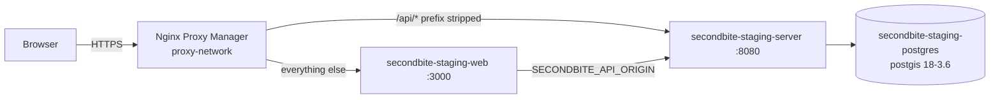

# SEC-33 — Staging at secondbite.vadan.app: design

Status: proposed on 18 October 2026. The team decided the same day to deploy staging now, at `secondbite.vadan.app`; the production address is not chosen. The open choices are in [Decisions](#decisions). Not built ([plan](plan.md)). Tracked in Linear as SEC-33, with SEC-35 (the Flutter browser preview) and SEC-34 (mobile CI).

## What the team gets

- Every merge to `main` that passes CI is running at `https://secondbite.vadan.app` a few minutes later:
  - the web for customers;
  - `/api` reaching the Go server;
  - later, the Flutter browser preview (SEC-35).
- A deployment that fails leaves the previous release named and a database dump taken just before it, so the team can go back.
- No one deploys from a laptop, and no secret passes through Git, Linear or chat.

## Reference

BeyondPilot already deploys to the same host this way, from its `docs/runbooks/ci-cd.md`, `infrastructure/deployment/` and `.github/workflows/deploy*.yml` (revision `bb7c2ac7`). This design copies it and leaves out what Second Bite does not have:
- no Flyway (the Go server migrates at start);
- no Spring profiles;
- no production environment yet.

The hosting decision in [vision](../../../vision.md) (16 October 2026) holds:
- Second Bite runs as its own Compose project, with its own directory, PostgreSQL container, volumes and network;
- traffic comes in through the host's Nginx Proxy Manager;
- nothing of BeyondPilot or MemoryOS is touched.

## Shape

- **Images:** `ghcr.io/kl3init/second-bite-{server,web}`, tagged `sha-<sha>-<run>-<attempt>` and never `latest`. Each carries the OCI label `org.opencontainers.image.revision`.
- **The server image** (`server/Dockerfile`, new):
  - a static Go build;
  - runs on a distroless non-root base pinned by digest;
  - health checks on `/livez` and `/readyz`, which the server already serves.
- **The server's settings** stay as `server/internal/platform/config.go` reads them:
  - `SECONDBITE_DATABASE_URL` without the password, and `SECONDBITE_LOG_FORMAT=json`.
  - Secrets come from files under `/run/secrets`, as the server already does:
    - `SECONDBITE_DATABASE_PASSWORD`;
    - `SECONDBITE_EMAIL_SETTINGS_KEY` and `SECONDBITE_SIGN_IN_CODE_KEY`, 32 bytes in base64 each.
  - Files are kept in PostgreSQL, the default of `SECONDBITE_FILE_STORE`, until an S3 store is chosen.
- **The web** gets `SECONDBITE_API_ORIGIN=http://secondbite-staging-server:8080` for the pages it renders. The browser's `/api` is routed by the proxy, as `web/next.config.ts` already expects.

## Release and deployment

1. **CI on a `main` push:**
   - builds both images and starts them together with PostgreSQL;
   - checks `/livez`, `/readyz`, the home and `/api` through a local proxy;
   - pushes the exact images it tested.
   - A final job runs only when every other job passed. It publishes the artifact `release-<sha>`, whose `images.env` names both images by digest. Nothing else can be deployed.
2. **Deploy staging** (`.github/workflows/deploy-staging.yml`, calling the reusable `deploy.yml`):
   - runs after a successful CI run on `main` when `STAGING_AUTO_DEPLOY` is `true`, and by hand at any time;
   - copies `images.env`, `deploy.sh` and the Compose files to `/apps/secondbite-staging/incoming/<release>/` over SSH, with a pinned host key and the staging deployment key;
   - runs `deploy.sh staging <release> <actor>` under one sudo rule.
3. **`deploy.sh`:**
   - takes the environment's lock;
   - refuses a malformed release, or an environment file not owned by root with mode `0600`;
   - pulls the images and checks their revision label;
   - dumps PostgreSQL to `backups/pre-deploy-<release>.dump` when a database is running;
   - runs `docker compose up --wait`: PostgreSQL, then the server (which migrates), then the web;
   - records `deployments/current.env` and `previous.env`.
4. **Nightly backup:** a systemd timer dumps the database. The fourteen newest dumps are kept on the host until an off-host target is chosen.

## The host, provisioned once by an administrator

These steps are written as commands in the runbook. The agent has no access to the host and records no address or secret.

- DNS: an A record for `secondbite.vadan.app`.
- The user `secondbite-ci`: no password and not in the `docker` group. Its only sudo rule runs `deploy.sh` from `incoming`.
- `/apps/secondbite-staging/{incoming,deployments,backups,secrets}` with BeyondPilot's owners and modes. The three secret files are generated on the host with `openssl rand` and never printed.
- GitHub environment `staging`, limited to `main`:
  - variables `STAGING_HOST`, `STAGING_USER` and `STAGING_KNOWN_HOSTS`;
  - secret `STAGING_SSH_KEY`;
  - repository variable `STAGING_AUTO_DEPLOY`.
- Nginx Proxy Manager: a proxy host for `secondbite.vadan.app` with Let's Encrypt, Force SSL and HTTP/2, forwarding to `secondbite-staging-web:3000`.
  - Its advanced configuration sends `/api/` to `secondbite-staging-server:8080` with the prefix stripped.
  - The upstream is a variable, so nginx keeps working while the container is being replaced.
  - The proxy replaces `X-Forwarded-For` and drops `Forwarded`, as on BeyondPilot.

## Rules that start with it

- **Migrations:** [persistence guideline](../../../guidelines/persistence.md) records the date of the first deployment that holds data. From then on, migrations are forward-only.
- **Indexing:** staging is never indexed. The web answers `robots.txt` with `Disallow: /` everywhere until the production address exists.
- **Shared host:** never run `docker system prune` or `docker volume prune` on the host; they act on BeyondPilot and MemoryOS.

## Decisions

### 1. Copy BeyondPilot's deployment rather than design a new one

Proposed: the same host, the same proxy and the same release-by-artifact and SSH-with-one-sudo-rule model that BeyondPilot already runs there. The team operates one way of deploying, not two.

### 2. Automatic deployment after every green `main`

Proposed: `STAGING_AUTO_DEPLOY=true` from the first deployment, as BeyondPilot's staging does. The pilot needs the newest build in front of the founder and the sellers. The server stops for a few seconds while it migrates.

### 3. Files in PostgreSQL on staging

Proposed: keep the default store, so staging needs no S3 account. Moving to S3 later is a change of settings plus a copy (SEC-21).
