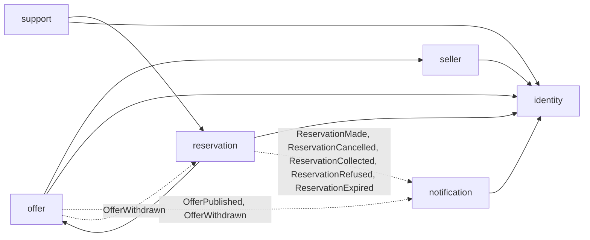

# Pilot domain model

Status: draft for review, 16 October 2026. No code exists. Tracked in Linear as SEC-6; the open questions are SEC-7.

This increment works the pilot's journey through [boundary discovery](../../../conventions.md#boundary-discovery), steps 1 to 5, and proposes the modules the backend starts with. Each module is then built in an increment of its own, which narrows this model to what its first consumer needs. Sources: the [brief](../../../brief/second-bite-project-brief.md), the [kickoff transcript](../../../research/sources/2026-10-16-kickoff-meeting-transcript.md) and [similar products](../../../research/2026-10-16-similar-products.md).

## What people will be able to do

- **A seller's staff** post surplus at the end of service by speaking it ("three croissants, two loaves of rye"), correct the draft, set the price and the collection window, and publish. They see what is reserved, and hand it over when a customer shows a code.
- **A customer** sees offers near them with the original and the offer price, the distance and the collection window, reserves units, and collects them, or sends someone else with the code.
- **An operator** verifies a seller before it can publish, suspends one that breaks the rules, and answers customers' support requests.

## 1. Domain story

**Actors:** customer, collector (the person who actually collects, the customer or someone they send), seller staff, seller owner, operator.

1. An operator verifies a seller: its name, its location in Tasco Mall, its owner. The owner invites their staff.
2. Near the end of service, a member of staff confirms what is left that would otherwise be thrown away. They describe it by voice or in writing; a draft offer is proposed; they correct it, set the number of units, the original and the offer price and the collection window, and publish it.
3. Earlier in the day a seller may announce **expected surplus** ("bread, usually after 20:30"). Customers may follow it; nobody can reserve it until staff confirm it as stock.
4. A customer nearby sees the offer, reserves two units and receives a collection code. They may pass the code to someone else.
5. Before the window closes the customer is reminded.
6. At the counter the collector shows the code. Staff check the food is still suitable, hand it over and confirm the collection. The customer pays at the counter during the pilot (open question 2).

**Failure and recovery paths**

- *Sold out between seeing and reserving:* the reservation is refused with its reason; nothing is held.
- *The customer taps Reserve twice:* one reservation is made.
- *The customer cancels before the window:* the units return to the offer.
- *Nobody comes before the window closes:* the reservation expires; the units are not offered again, because the window is over.
- *The seller withdraws the offer:* its reservations are cancelled and the customers told.
- *Staff judge the food unsuitable at the handover:* they refuse the collection with a reason; the customer is told and does not pay.
- *Wrong codes are tried:* after a bounded number of attempts the code is locked and the staff call support.
- *A customer has a problem* (closed counter, wrong food): they open a support request tied to the reservation.

## 2. Glossary

| Term | Meaning | Not to be confused with |
| --- | --- | --- |
| Seller | A business that sells surplus: one food and beverage outlet in the pilot, with one collection point | "shop", "restaurant", "store", "supplier": all are a Seller in the product |
| Staff member | A person who acts for a seller, as its owner or as staff | Operator |
| Operator | A person of the Second Bite team who verifies sellers and handles support | Staff member |
| Customer | A person who reserves | Collector |
| Collector | The person who collects with the code; the customer unless they sent someone | — |
| Offer | Surplus a seller makes available: what it is, its kind (ingredients, bakery, prepared food), its units, its original and offer price per unit, its collection window | "listing", "product", "order" |
| Box | An offer whose unit is a mixed bag described by its contents and value rather than itemized; the brief's next iteration ("grouped boxes") | — |
| Expected surplus | An offer announced before the stock exists; it can be followed, not reserved | Confirmed stock |
| Confirmed stock | An offer whose units exist now and can be reserved | — |
| Offer draft | A proposal for an offer made from staff's spoken or written description, never published without staff confirming it | Offer |
| Collection window | When an offer can be collected, from and until | Opening hours |
| Reservation | A customer's hold on units of one offer until the window closes | "order", "booking" |
| Collection code | A short single-use secret that proves the right to collect one reservation | — |
| Collection | The handover at the counter that completes a reservation | Delivery (not in the pilot) |
| Platform fee | What Second Bite takes from the offer price; zero during the pilot | Discount |
| Support request | A customer's or seller's request for help, possibly about one reservation | — |

"Order" is not used: what a customer makes is a reservation, and it ends in a collection.

## 3. Commands, facts, aggregates and read models

| Command | By | Fact | Aggregate (consistency boundary) |
| --- | --- | --- | --- |
| Verify, suspend, restore a seller | Operator | `SellerVerified`, `SellerSuspended` | Seller |
| Invite, remove staff | Seller owner | — | Seller |
| Draft an offer from a description | Staff | — | Offer draft |
| Publish an offer; announce expected surplus; confirm it as stock | Staff | `OfferPublished` | Offer |
| Change units, withdraw an offer | Staff | `OfferWithdrawn` | Offer |
| Follow expected surplus | Customer | — | Offer |
| Reserve units | Customer | `ReservationMade` | Reservation, with the offer's units |
| Cancel a reservation | Customer | `ReservationCancelled` | Reservation |
| Confirm or refuse a collection | Staff | `ReservationCollected`, `ReservationRefused` | Reservation |
| Expire reservations whose window closed | System | `ReservationExpired` | Reservation |
| Open, answer, resolve a support request | Customer, staff, operator | — | Support request |

**Synchronous invariants**

- An offer's units left are never negative, and a reservation exists only for units that were left. Reserving and decrementing happen in one transaction.
- Only a verified, unsuspended seller's staff can publish.
- Only confirmed stock inside an open window can be reserved.
- A collection code works once, for its reservation, inside its window.

**Asynchronous reactions:** cancelling reservations when an offer is withdrawn; notifying followers when expected surplus is confirmed; reminders before a window closes; expiring reservations; push notifications for every fact a person should hear.

**Read models:** offers near a point (distance, window, price), a seller's evening (its offers and the reservations to hand over), a customer's reservations, the operators' sellers and support queues, and pilot measures (units offered, reserved, collected, expired).

## 4. Data and invariant owners

| Module | Owns (tables) | Invariants and lifecycles |
| --- | --- | --- |
| `identity` | accounts, sign-in challenges, sessions or refresh tokens | One account per verified phone number or email; roles customer, operator |
| `seller` | sellers, staff memberships, verification history | Verification and suspension; who acts for a seller |
| `offer` | offers, offer drafts, follows of expected surplus | Units left; kinds of offer; publishing rules; the offer's collection point |
| `reservation` | reservations, collection codes, collection attempts | Hold, cancellation, expiry, collection and refusal; single-use codes |
| `notification` | device push tokens, sent notifications | What a person is told, once |
| `support` | support requests and their messages | A request's lifecycle |

**Ownership decisions to confirm**

- **The offer keeps its collection point.** The nearby-offers query must not read `seller`'s tables, so an offer copies its seller's collection point (a PostGIS point) when it is published. A seller that moves changes future offers only.
- **Units belong to `offer`, the hold to `reservation`.** `reservation` asks `offer` to take units through `offer`'s published API inside its own transaction, and to give them back on cancellation. `offer` never reads reservations.
- **AI provider settings stay inside `offer`** while drafting offers is the only use of AI. A second use (natural-language search, from the kickoff) is the evidence for an `ai` module of its own.
- **Operators' decisions** are kept as each module's own history (a seller's verification history) until a second module needs an audit record; then an `audit` module, as BeyondPilot has, is the candidate.

## 5. Context map

Solid arrows are synchronous calls through the target's published API; dotted arrows are events, delivered after commit through the outbox ([events between modules](../../../conventions.md#events-between-modules)). There is no cycle: `offer` learns nothing from `reservation`, and a withdrawal reaches reservations by an event.

| Edge | Why | Consistency | On failure |
| --- | --- | --- | --- |
| `reservation → offer` (take, return units) | The units invariant | Same transaction | The reservation is refused (`RESERVATION_OFFER_SOLD_OUT`) |
| `offer → seller` (may this person publish for this seller; its collection point) | Publishing rule | Read in the publishing transaction | Publishing is refused |
| `OfferWithdrawn → reservation` | Cancel the holds | Eventual, idempotent | Redelivered until it succeeds |
| facts → `notification` | Tell people | Eventual, idempotent | A notification may arrive late, never twice |

Non-functional needs: a reservation answers in under a second at the pilot's load; codes and phone numbers never reach logs; expiry runs within a minute of a window closing.

## Interchangeable implementations

The pilot's vendor families, built with [Strategy behind a registry](../../../conventions.md#interchangeable-implementations-strategy-behind-a-registry) from their first implementation:

| Function | Owner | Implementations in view |
| --- | --- | --- |
| Draft an offer from text | `offer` | Claude, OpenAI |
| Turn speech into text | `offer` | A self-hosted Whisper model, a hosted speech API |
| Store and serve images of offers | `offer` (until a second module stores files) | Local directory in development, MinIO or another S3-compatible store when deployed |

Push goes through Firebase Cloud Messaging alone, which reaches iOS through APNs, so it has no registry.

## Open questions

| # | Question | Who answers | Why it matters to the model |
| --- | --- | --- | --- |
| 1 | The fee after the pilot: 20% of the offer price, as the founder proposed, or another model (sponsorship, advertising), as the sponsor suggested | Founder, sponsor | Whether the fee is stored per reservation now (at 0) |
| 2 | Does a customer pay in advance, at the counter, or neither during the pilot? | Founder | Payment state on a reservation; no-show handling |
| 3 | How long is a reservation held: until the window closes, or a set time after it is made? | Founder with sellers | Expiry rule |
| 4 | Is there a minimum discount the platform requires, and is it per kind of food? | Founder with sellers (survey) | Validation when publishing |
| 5 | How many units may one customer hold at once, and is a customer who does not come limited? | Founder | Limits on reserving |
| 6 | How are followers of expected surplus told, and how often at most? | Founder | Follows and notification rules |
| 7 | Does an offer carry allergens or ingredients beyond its description? | Founder, food-safety advice | Offer fields |
| 8 | How is avoided disposal measured: units collected, an estimated weight per offer, the seller's own count? | Founder | Measures to store per offer and collection |
| 9 | How do customers sign in: phone number with a code (SMS or Zalo cost), or email? | Team | `identity` and its cost |
| 10 | Are offers written in one language and shown as written, or translated? | Founder | Offer text fields |
