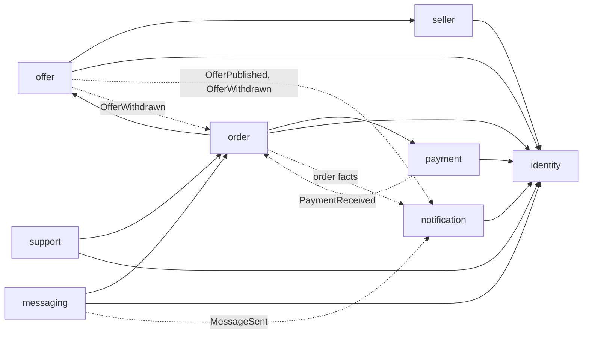

# Pilot domain model

Status: completed, 31 October 2026: every module it proposed was taken by an increment of its own. Earlier: draft for review, 16 October 2026. No code exists. Tracked in Linear as SEC-6; the remaining question is SEC-7, the reading of comparable projects SEC-8.

This increment works the pilot's journey through [boundary discovery](../../../conventions.md#boundary-discovery), steps 1 to 5, and proposes the modules the backend starts with. Each module is then built in an increment of its own, which narrows this model to what its first consumer needs.

Sources: the founder's [requirements for the IT team](../../../brief/second-bite-app-requirements-it.md) (the newest statement, 16 October 2026), the [project brief](../../../brief/second-bite-project-brief.md), the [kickoff transcript](../../../research/sources/2026-10-16-kickoff-meeting-transcript.md), [similar products](../../../research/2026-10-16-similar-products.md) and [how open-source food projects model pickups](../../../research/2026-10-16-open-source-pickup-models.md).

## What people will be able to do

- **A seller's staff** post surplus at the end of service by speaking it, writing it or photographing it ("two apples and three spring rolls"), correct the draft, set the price and the collection window, and publish. They see new orders, mark them ready, and hand them over when a customer shows a code. They chat with a customer about an order.
- **A customer** finds offers near them by typing, filtering or speaking, sees the price, the distance and the collection window, orders units, pays in cash or by bank transfer, follows the order, chats with the seller, and collects with a code, or sends someone else with it.
- **An admin** verifies a seller before it can publish, suspends one that breaks the rules, sees orders and their payments, handles problem reports and cancellation requests, and downloads reports.

## Decisions taken from the requirements

Taken with the team on 16 October 2026 after reading the requirements deck.

| Topic | Decision | Basis |
| --- | --- | --- |
| Commission | None, ever: Second Bite takes no share of a seller's sales. Third-party fees (payment, delivery) are shown separately | Deck, slides 1 and 10: non-profit, commission zero |
| Delivery | Not in the pilot. An order has a fulfilment method, and the pilot offers only collection; delivery through a partner (Grab, Xanh SM) is enabled only once an agreement and a working integration exist | Deck, slide 7; decided with the team |
| Payment | Cash at the counter, or a bank transfer by VietQR confirmed through SePay. Payment providers are a vendor family behind a registry, so another provider (a card gateway, an e-wallet) is a new implementation | Deck, slide 10; decided with the team |
| Order confirmation | An order is confirmed by the system when it is placed and the units exist, as in Too Good To Go, Karrot and Open Food Network; staff do not accept each order. An order paid by transfer waits for the payment ("awaiting payment") for a bounded time, then is cancelled and its units returned. Staff mark an order ready and hand it over | Deck, slide 9's states, mapped onto the references; the team left the choice to the design |
| Chat | One conversation per order between the customer and the seller's staff, with text and images | Deck, slide 8 |
| Platforms | A web application in React on the stack BeyondPilot uses, for customers, sellers and admins on a computer; the mobile application is still to be decided | Deck, slide 11; decided with the team |

## 1. Domain story

**Actors:** customer, collector (the person who actually collects: the customer or someone they send), seller staff, seller owner, admin.

1. A seller's owner creates a shop with its name, address, photo and contact; an admin verifies it before it can publish. The owner invites their staff.
2. Near the end of service, staff confirm what is left that would otherwise be thrown away. They describe it by voice, in writing or with a photo; a draft offer is proposed and asks for what is missing (price, collection time); they correct it and publish it with its units, unit, price and collection window.
3. Earlier in the day a seller may announce **expected surplus**. Customers may follow it; nobody can order it until staff confirm it as stock.
4. A customer finds the offer by name, price, distance or collection time, or asks in words ("rice within 2 km, under 60,000 đồng"). They order two units for collection and choose cash or transfer. The total is shown before they order.
5. With cash the order is confirmed at once. With a transfer the customer is shown a VietQR code; the order waits for the payment and is confirmed when SePay reports it.
6. The customer and the staff can chat about the order. Before the window closes the customer is reminded; staff mark the order ready.
7. At the counter the collector shows the code. Staff check the food is still suitable, hand it over and confirm the collection. A cash order is paid then.

**Failure and recovery paths**

- *Sold out between seeing and ordering:* the order is refused with its reason; nothing is held.
- *The customer taps Order twice:* one order is made.
- *A transfer never arrives:* the order is cancelled when its payment time runs out, and the units return to the offer.
- *A transfer arrives after the order was cancelled, or for a different amount:* the payment is recorded against the order and flagged for an admin to refund.
- *The customer cancels before the window:* the units return; a paid order goes to an admin as a refund request.
- *Nobody comes before the window closes:* the order expires as not collected; its units are not offered again, because the window is over.
- *The seller withdraws the offer:* its open orders are cancelled and the customers told; paid ones become refund requests.
- *Staff judge the food unsuitable at the handover:* they refuse the collection with a reason; the customer is told, and a paid order becomes a refund request.
- *Wrong codes are tried:* after a bounded number of attempts the code is locked and the staff call support.
- *The AI cannot read a description or a photo:* the staff are asked to check it or type it; the AI never states that food is safe or when it expires.
- *The AI search fails:* the customer searches and orders with ordinary filters.
- *A customer or a seller has a problem:* they report it, tied to the order when there is one.

## 2. Glossary

| Term | Meaning | Not to be confused with |
| --- | --- | --- |
| Seller | A business that sells surplus ("quán"): one food and beverage outlet in the pilot, with one collection point | "shop", "restaurant", "store", "supplier": all are a Seller in the product |
| Staff member | A person who acts for a seller, as its owner or as staff | Admin |
| Admin | A person of the Second Bite team ("quản trị") who verifies sellers, handles problem reports and refunds, and reads reports; named as Open Food Network and Spree name theirs (decided with the team on 17 October 2026) | Staff member, and a seller's owner, who is not an admin |
| Customer | A person who orders | Collector |
| Collector | The person who collects with the code: the customer unless they sent someone | — |
| Offer | Surplus a seller makes available: what it is, its kind (ingredients, bakery, prepared food), its photo, its units and unit, its price per unit, its collection window | "listing", "product", "post" |
| Box | An offer whose unit is a mixed bag described by its contents and value rather than itemized; the brief's next iteration ("grouped boxes") | — |
| Expected surplus | An offer announced before the stock exists; it can be followed, not ordered | Confirmed stock |
| Confirmed stock | An offer whose units exist now and can be ordered | — |
| Offer draft | A proposal for an offer made from staff's spoken, written or photographed description, never published without staff confirming it | Offer |
| Collection window | When an offer can be collected: from when it is ready until the last handover | Opening hours |
| Order | A customer's order ("đơn") for units of one offer, with its fulfilment method, its payment method and its total | "reservation", "booking" |
| Fulfilment method | How the customer receives an order: collection at the counter, or delivery (not in the pilot) | — |
| Collection code | A short single-use secret that proves the right to collect one order | — |
| Collection | The handover at the counter that completes a collection order | Delivery |
| Payment | Money for one order: its method (cash, bank transfer), provider, amount and state | Commission (there is none) |
| Refund | Money returned to a customer for a paid order that was not fulfilled, decided by an admin | Cancellation |
| Conversation | The chat of one order between its customer and the seller's staff | Problem report |
| Problem report | A customer's or a seller's report to the admins ("báo lỗi"), possibly about one order | Conversation |

## 3. Commands, facts, aggregates and read models

| Command | By | Fact | Aggregate (consistency boundary) |
| --- | --- | --- | --- |
| Create a shop; verify, suspend, restore it | Owner; admin | `SellerVerified`, `SellerSuspended` | Seller |
| Invite, remove staff | Seller owner | — | Seller |
| Draft an offer from words, voice or a photo | Staff | — | Offer draft |
| Publish an offer; announce expected surplus; confirm it as stock | Staff | `OfferPublished` | Offer |
| Change units, hide, withdraw an offer | Staff | `OfferWithdrawn` | Offer |
| Follow expected surplus | Customer | — | Offer |
| Place an order | Customer | `OrderPlaced` | Order, with the offer's units |
| Record a payment received | System (SePay) | `PaymentReceived` | Payment |
| Confirm an order paid by transfer; cancel one whose payment time ran out | System | `OrderConfirmed`, `OrderCancelled` | Order |
| Cancel an order | Customer, staff | `OrderCancelled` | Order |
| Mark an order ready | Staff | `OrderReady` | Order |
| Confirm or refuse a collection | Staff | `OrderCollected`, `OrderRefused` | Order |
| Expire orders whose window closed | System | `OrderExpired` | Order |
| Decide a refund | Admin | `RefundDecided` | Payment |
| Send a message in an order's conversation | Customer, staff | `MessageSent` | Conversation |
| Report a problem; answer and resolve it | Customer, staff, admin | — | Problem report |

**Synchronous invariants**

- An offer's units left are never negative, and an order exists only for units that were left: when two customers order the last unit, one order is confirmed (deck, slide 9). Ordering and decrementing happen in one transaction.
- Only a verified, unsuspended seller's staff can publish.
- Only confirmed stock inside an open window can be ordered.
- A collection code works once, for its order, inside its window.
- A customer reads only their own orders and conversations; staff read only those of their seller (deck, slide 8).
- A message never changes an order's price, units or address; a change to an order is its own command (deck, slide 8).

**Asynchronous reactions:** cancelling open orders when an offer is withdrawn; confirming or cancelling orders when a payment arrives or its time runs out; notifying followers when expected surplus is confirmed; reminders before a window closes; expiring orders; notifications for every fact a person should hear.

**Read models:** offers near a point (distance, window, price, fulfilment method); a seller's evening (its offers and the orders to prepare and hand over); a customer's orders; an order's conversation; the admins' sellers, orders and payments, problem reports and refund requests; reports of completed orders, money paid and refunded by seller and day, downloadable as Excel or CSV (deck, slide 10); pilot measures (units offered, ordered, collected, expired).

## 4. Data and invariant owners

| Module | Owns (tables) | Invariants and lifecycles |
| --- | --- | --- |
| `identity` | accounts, sign-in challenges, sessions | One account per verified email; roles customer and admin |
| `seller` | sellers, staff memberships, verification history | Verification and suspension; who acts for a seller |
| `offer` | offers, offer drafts, follows of expected surplus | Units left; kinds of offer; publishing rules; the offer's collection point |
| `order` | orders, collection codes, collection attempts, order events (every transition, never a deleted row) | Placement, payment wait, confirmation, readiness, cancellation, expiry, collection and refusal; single-use codes; not-collected recorded when a window closes |
| `payment` | payments, provider transactions, refunds | A payment's state; matching a provider's transaction to an order exactly once; refunds decided by admins |
| `messaging` | conversations, messages, read positions | One conversation per order; who may read it |
| `notification` | device push tokens, sent notifications | What a person is told, once |
| `support` | problem reports and their messages | A report's lifecycle |

**Ownership decisions to confirm**

- **The offer keeps its collection point.** The nearby-offers query must not read `seller`'s tables, so an offer copies its seller's collection point (a PostGIS point) when it is published. A seller that moves changes future offers only.
- **Units belong to `offer`, the order to `order`.** `order` asks `offer` to take units through `offer`'s published API inside its own transaction, and to give them back on cancellation. `offer` never reads orders.
- **Money belongs to `payment`.** `order` asks `payment` to open a payment for an order and learns its outcome by `PaymentReceived` or by the payment time running out; `payment` never changes an order. The pilot holds no money: a transfer goes to the seller's own bank account (open question in [questions that remain](#questions-that-remain)).
- **AI provider settings stay inside `offer`** while drafting offers is the only use of AI; the customers' AI search is the second use, and with it an `ai` module of its own is the candidate.
- **Admins' decisions** are kept as each module's own history until a second module needs an audit record; then an `audit` module, as BeyondPilot has, is the candidate.

## 5. Context map

Solid arrows are synchronous calls through the target's published API; dotted arrows are events, delivered after commit through the outbox ([events between modules](../../../conventions.md#events-between-modules)). There is no cycle: `offer` learns nothing from `order`, a withdrawal reaches orders by an event, and `payment` tells `order` about money by an event.

| Edge | Why | Consistency | On failure |
| --- | --- | --- | --- |
| `order → offer` (take, return units) | The units invariant | Same transaction | The order is refused (`ORDER_OFFER_SOLD_OUT`) |
| `order → payment` (open a payment for an order) | A transfer needs a payment reference and a VietQR code | Same transaction | The order is not placed |
| `offer → seller` (may this person publish for this seller; its collection point) | Publishing rule | Read in the publishing transaction | Publishing is refused |
| `messaging → order` (is this person a participant of this order) | Who may read and write | Read per request | Refused (`MESSAGING_NOT_A_PARTICIPANT`) |
| `PaymentReceived → order` | Confirm a waiting order | Eventual, idempotent | Redelivered until it succeeds |
| `OfferWithdrawn → order` | Cancel open orders | Eventual, idempotent | Redelivered until it succeeds |
| facts → `notification` | Tell people | Eventual, idempotent | A notification may arrive late, never twice |

Non-functional needs: an order answers in under a second at the pilot's load; codes, bank details and phone numbers never reach logs; a SePay notification is verified and processed once even when delivered twice; expiry runs within a minute of a window closing; the system never shows an order as successful before it is (deck, slide 11).

## Interchangeable implementations

The pilot's vendor families, built with [Strategy behind a registry](../../../conventions.md#interchangeable-implementations-strategy-behind-a-registry) from their first implementation:

| Function | Owner | Implementations in view |
| --- | --- | --- |
| Take payment for an order | `payment` | Cash at the counter, SePay (VietQR bank transfer); later a card gateway or an e-wallet |
| Draft an offer from text or a photo | `offer` | Claude, OpenAI |
| Turn speech into text | `offer` | A self-hosted Whisper model, a hosted speech API |
| Store and serve images | `offer`, then `messaging` (with its first image, the candidate for a module of its own) | Local directory in development, MinIO or another S3-compatible store when deployed |
| Delivery (after the pilot) | a `delivery` module when it starts | Grab Express, Xanh SM |

Push goes through Firebase Cloud Messaging alone, which reaches iOS through APNs, so it has no registry.

## Working assumptions

Business details wait until the pilot shows what matters, as agreed at the kickoff ([transcript, 26:22–26:40](../../../research/sources/2026-10-16-kickoff-meeting-transcript.md)). Until then the model works to these assumptions, taken from the requirements, the kickoff and from [how other projects do it](../../../research/2026-10-16-open-source-pickup-models.md). Each is a setting or a small change, not a structural one; a later answer replaces it here.

| # | Topic | Assumption for the pilot | Basis |
| --- | --- | --- | --- |
| 1 | Hold | A confirmed order holds its units until its collection window closes | Too Good To Go's model; Karrot's activity window |
| 2 | Payment wait | An order paid by transfer waits a set time (a setting, 15 minutes to start) for its payment | Bounded holds; nothing reserved forever |
| 3 | Minimum discount | A platform setting checked when publishing, at 20%; a seller may give more | Founder, 18 October 2026 (it was 0% until then); kickoff: the platform sets a minimum |
| 4 | Limits | A setting for the units one customer may hold per day; orders not collected are recorded, without a penalty yet | foodsharing's per-person limits; no-show policy deferred |
| 5 | Followers of expected surplus | Told once, when the seller confirms it as stock | Simplest rule that serves the brief |
| 6 | Allergens | Part of the description written by staff; no structured field yet | Staff check suitability at the handover |
| 7 | Language | Offers are shown as written; the interface is bilingual; the AI answers in the customer's language | Deck, slides 6 and 11 |
| 8 | Sign-in | Email with a one-time code, no password; a phone number later if customers need it | Every reference signs in by email; no SMS cost; BeyondPilot's code sign-in |
| 9 | Avoided disposal | Units offered, ordered, collected and expired are recorded per offer; an estimated weight per unit is optional on the offer | The brief measures avoided disposal separately against a baseline |

## Questions that remain

| Question | Who answers | Why it cannot wait for the pilot |
| --- | --- | --- |
| What baseline of disposal is measured before the pilot starts, and by whom? | Founder, with the sellers | Avoided disposal is measured against it; a baseline cannot be taken after the pilot begins |
| Does a customer's transfer go to the seller's own bank account, each seller connecting it to SePay, or through an account Second Bite holds? | Founder, with legal advice | Holding customers' money may require a payment licence; a seller's own account avoids it but needs each seller's bank and SePay set-up |
